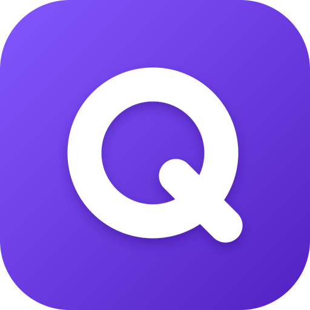
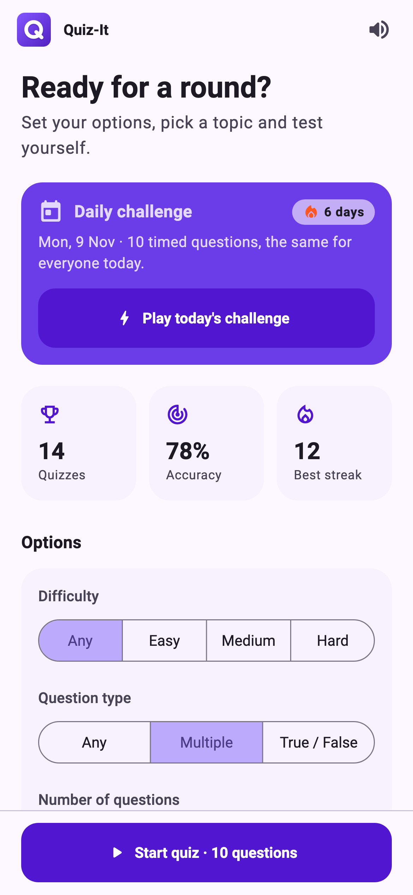
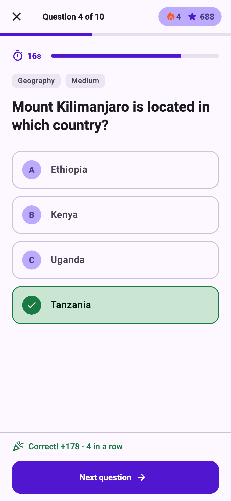
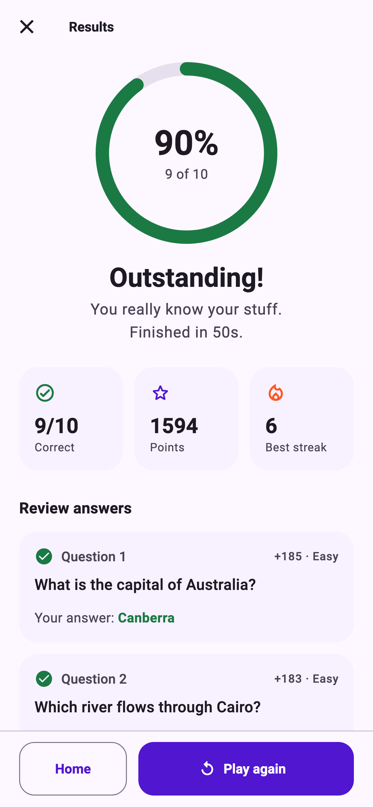
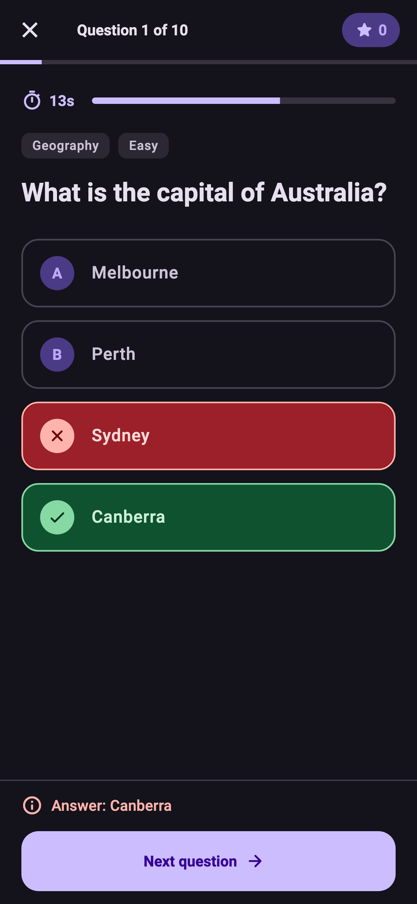

<div align="center">



# Quiz-It

[](LICENSE) [](https://flutter.dev/) [](https://dart.dev/) [](https://pub.dev/packages/flutter_riverpod)

**A clean, fast trivia quiz app built with Flutter.**

A cross-platform quiz application built with [Flutter](https://flutter.dev/)
that pulls trivia questions from the [Open Trivia
Database](https://opentdb.com/) — pick a topic, play a round, and review your
answers. Runs on Android, iOS, and Web.

</div>

---

## Screenshots

<table>
  <tr>
    <td width="25%"></td>
    <td width="25%"></td>
    <td width="25%"></td>
    <td width="25%"></td>
  </tr>
</table>

## Features

- **Cross-platform** — runs on Android, iOS, and Web from a single codebase.
- **Material 3 design** — light and dark themes that follow the system
  setting, and a centred layout that scales from phones to desktop browsers.
- **Quiz setup** — choose from 24 categories, a difficulty, multiple choice or
  true / false questions, and a round of 5–20 questions.
- **Daily challenge** — 10 timed questions a day, the same for every player,
  with a daily streak. Works offline from a bundled question bank.
- **Timed mode** — an optional 20-second countdown per question; faster
  answers earn up to double points.
- **Focused quiz flow** — one question at a time with a progress bar, instant
  right / wrong feedback, a running score and streak, and questions that
  slide in from the right.
- **Keyboard shortcuts** — 1–4 (or A–D) to answer and Enter to continue, on
  web and desktop.
- **Sound, vibration, and confetti** — feedback on every answer (with a mute
  toggle) and a confetti burst for scores of 80% or more.
- **Results and review** — an animated score, points, round stats, and a
  review of every question with the correct answer.
- **Stats that stick** — quizzes played, accuracy, and best streak overall,
  plus your best score and accuracy on every category tile. Saved on the
  device along with your settings.
- **No repeats** — an Open Trivia DB session token stops questions repeating
  while the app is open.
- **Friendly errors** — clear, retryable messages when you're offline, the API
  is rate limited, or a category doesn't have enough questions.

## How It Works

1. **Set up a round** — pick options and a category on the home screen.
2. **Fetch the quiz** — `QuizNotifier.start()` asks the `TriviaApi` client for
   questions from the Open Trivia Database.
3. **Answer and score** — each answer is locked in on the current
   `QuizSession`; finishing the round records it in your lifetime stats.

> There is no backend of its own — the app talks directly to the public Open
> Trivia Database API, and nothing is stored off-device.

## Project Structure

```text
lib/
├── main.dart           # Opens storage and starts the app
├── app.dart            # MaterialApp and themes
├── data/               # Open Trivia DB client, category catalog, daily bank
├── models/             # Immutable models: question, session, settings, stats
├── state/              # Riverpod notifiers, storage, sound and haptics
├── screens/            # home/, quiz/ and results/, each with its own widgets
├── widgets/            # Widgets shared between screens
└── theme/              # Material 3 theme and extra semantic colours

assets/
├── logo.svg            # Master logo; every app icon is rendered from it
├── daily/              # Bundled question bank for the daily challenge
└── sounds/             # Sound effects

tool/
├── build_daily_bank.dart  # Re-downloads the daily question bank
├── logo.py                # Renders all app icons from the logo design
└── screenshots/           # Renders the README screenshots
```

## Tech Stack

| Area           | Tools                                                                                                                       |
| -------------- | --------------------------------------------------------------------------------------------------------------------------- |
| **Framework**  | [Flutter](https://flutter.dev/) · [Dart](https://dart.dev/)                                                                 |
| **State**      | [flutter_riverpod](https://pub.dev/packages/flutter_riverpod)                                                               |
| **Networking** | [http](https://pub.dev/packages/http)                                                                                       |
| **Storage**    | [shared_preferences](https://pub.dev/packages/shared_preferences)                                                           |
| **Audio**      | [audioplayers](https://pub.dev/packages/audioplayers)                                                                       |
| **Data**       | [Open Trivia Database](https://opentdb.com/)                                                                                |
| **Testing**    | [flutter_test](https://docs.flutter.dev/testing)                                                                            |
| **Tooling**    | [Flutter CLI](https://flutter.dev/docs/get-started/install) · [flutter_lints](https://pub.dev/packages/flutter_lints)       |

## Getting Started

These instructions will get you a copy of the project up and running on your
local machine for development purposes.

### Requirements

To install and run this project you need:

- [Flutter SDK](https://flutter.dev/docs/get-started/install) 3.47 or newer
  (Dart 3.13+)
- [git](https://git-scm.com/downloads) (only to clone this repository)
- Optional: [Chrome](https://www.google.com/chrome/) (for web debugging)
- Optional: an IDE with Flutter support —
  [Android Studio](https://developer.android.com/studio),
  [IntelliJ IDEA](https://www.jetbrains.com/idea/), or
  [Visual Studio Code](https://code.visualstudio.com/) with the
  [Flutter and Dart plugins](https://flutter.dev/docs/get-started/editor)

### Installation

To set up everything on your local machine, follow these steps:

1. Clone this repo and then change directory to the `quiz-it` folder:

```bash
git clone https://github.com/kaushalmeena/quiz-it.git
cd quiz-it
```

2. Install project dependencies using the Flutter CLI:

```bash
flutter pub get
```

### Running

To run the app on a connected device or simulator:

```bash
flutter run
```

To run it in the browser instead:

```bash
flutter run -d chrome
```

### Testing

To run the unit and widget tests (no network needed):

```bash
flutter test
```

To analyze the project for lint and type issues:

```bash
flutter analyze
```

### Building

To create a production build for a specific platform:

```bash
flutter build apk      # Android
flutter build ios      # iOS
flutter build web      # Web
```

The build output is written to the `build/` folder — `build/app/outputs` for
Android and `build/web` for the web bundle.

### Regenerating assets

To rebuild the daily challenge question bank (takes about two minutes because
of the API's rate limit):

```bash
dart run tool/build_daily_bank.dart
```

To re-render the logo and every app icon after editing the design in
`tool/logo.py` (needs `rsvg-convert` from `brew install librsvg`; the iOS step
uses macOS `sips`):

```bash
python3 tool/logo.py
```

To re-render the README screenshots after a UI change (uses the fonts that
ship with Flutter, a fixed date and sample data, so the output is stable):

```bash
flutter test tool/screenshots --update-goldens
```

## Credits

- Trivia questions provided by the [Open Trivia
  Database](https://opentdb.com/), licensed under
  [CC BY-SA 4.0](https://creativecommons.org/licenses/by-sa/4.0/). The
  bundled daily question bank (`assets/daily/questions.json`) is an unmodified
  selection of those questions under the same licence.

## Contributing

Contributions are welcome! If you find a bug or have a feature request, please
[open an issue](https://github.com/kaushalmeena/quiz-it/issues/new/choose)
first to discuss it. For code changes, fork the repository, create a branch,
and open a pull request.

## License

This project is licensed under the MIT License — see the [LICENSE](LICENSE)
file for details.
