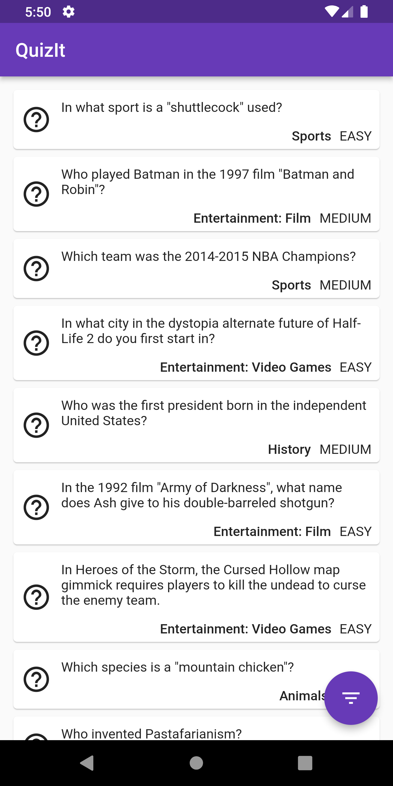
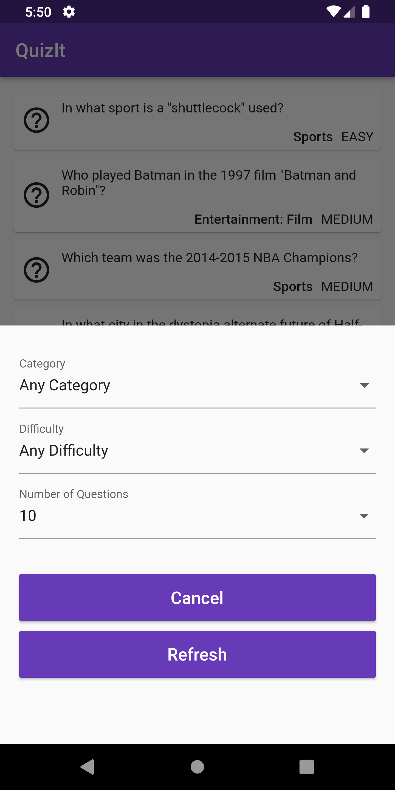
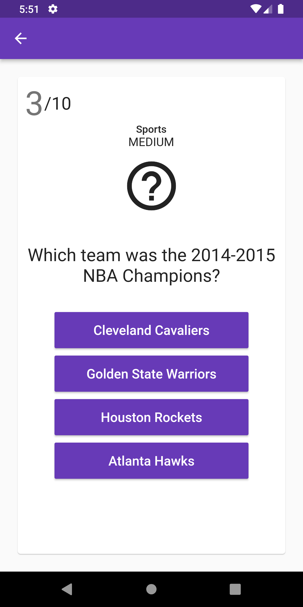

<div align="center">


# Quiz-It

[](LICENSE) [](https://flutter.dev/) [](https://dart.dev/) [](https://pub.dev/packages/async_redux)

**A Flutter quiz app powered by Redux for state management.**

A cross-platform quiz application built with [Flutter](https://flutter.dev/)
that pulls trivia questions from the [Open Trivia
Database](https://opentdb.com/) and keeps every answer, score, and filter in a
single **Async Redux** store — supporting Android, iOS, and Web.

</div>

---

## Screenshots

<table>
  <tr>
    <td width="33%"></td>
    <td width="33%"></td>
    <td width="33%"></td>
  </tr>
</table>

## Features

- **Cross-platform** — runs on Android, iOS, and Web from a single codebase.
- **Redux state management** — predictable, testable state for quiz progress
  and results, powered by
  [async_redux](https://pub.dev/packages/async_redux).
- **Quiz filtering** — pick the category, difficulty, and number of questions
  before starting a round.
- **Swipeable question cards** — questions are presented one per page in a
  swipeable `PageView`.
- **Instant answer feedback** — answers are marked in the store as you tap
  them, so the score stays in sync across screens.

## How It Works

1. **Pick your filters** — choose a category, difficulty, and question count
   from the filter sheet.
2. **Fetch the quiz** — a `FetchQuestions` action calls the Open Trivia
   Database API and stores the decoded questions in the Redux state.
3. **Answer and score** — each tap dispatches a `MarkAnswer` action; the store
   is the single source of truth for progress and results.

> There is no backend of its own — the app talks directly to the public Open
> Trivia Database API, and nothing is stored off-device.

## Tech Stack

| Area           | Tools                                                                                             |
| -------------- | ------------------------------------------------------------------------------------------------- |
| **Framework**  | [Flutter](https://flutter.dev/) · [Dart](https://dart.dev/)                                       |
| **State**      | [async_redux](https://pub.dev/packages/async_redux)                                               |
| **Networking** | [http](https://pub.dev/packages/http) · [html_unescape](https://pub.dev/packages/html_unescape)   |
| **Data**       | [Open Trivia Database](https://opentdb.com/)                                                      |
| **Testing**    | [flutter_test](https://docs.flutter.dev/testing) · [test](https://pub.dev/packages/test)          |
| **Tooling**    | [Flutter CLI](https://flutter.dev/docs/get-started/install)                                       |

## Getting Started

These instructions will get you a copy of the project up and running on your
local machine for development purposes.

### Requirements

To install and run this project you need:

- [Flutter SDK](https://flutter.dev/docs/get-started/install) with a Dart SDK
  in the `>=2.7.0 <3.0.0` range
- [git](https://git-scm.com/downloads) (only to clone this repository)
- Optional: [Chrome](https://www.google.com/chrome/) (for web debugging)
- Optional: an IDE with Flutter support —
  [Android Studio](https://developer.android.com/studio),
  [IntelliJ IDEA](https://www.jetbrains.com/idea/), or
  [Visual Studio Code](https://code.visualstudio.com/) with the
  [Flutter and Dart plugins](https://flutter.dev/docs/get-started/editor)

### Installation

To set up everything on your local machine, follow these steps:

1. Clone this repo and then change directory to the `quiz-it` folder:

```bash
git clone https://github.com/kaushalmeena/quiz-it.git
cd quiz-it
```

2. Install project dependencies using the Flutter CLI:

```bash
flutter pub get
```

### Running

To run the app on a connected device or simulator:

```bash
flutter run
```

To run it in the browser instead:

```bash
flutter run -d chrome
```

### Testing

To run the unit tests:

```bash
flutter test
```

To analyze the project for lint and type issues:

```bash
flutter analyze
```

### Building

To create a production build for a specific platform:

```bash
flutter build apk      # Android
flutter build ios      # iOS
flutter build web      # Web
```

The build output is written to the `build/` folder — `build/app/outputs` for
Android and `build/web` for the web bundle.

## Credits

- Trivia questions provided by the [Open Trivia
  Database](https://opentdb.com/), licensed under
  [CC BY-SA 4.0](https://creativecommons.org/licenses/by-sa/4.0/).

## Contributing

Contributions are welcome! If you find a bug or have a feature request, please
[open an issue](https://github.com/kaushalmeena/quiz-it/issues/new/choose)
first to discuss it. For code changes, fork the repository, create a branch,
and open a pull request.

## License

This project is licensed under the MIT License — see the [LICENSE](LICENSE)
file for details.
